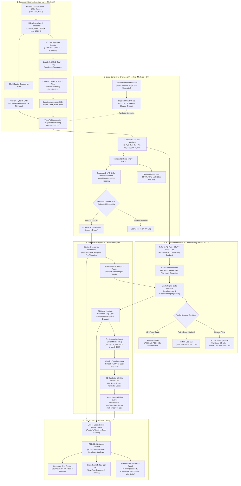
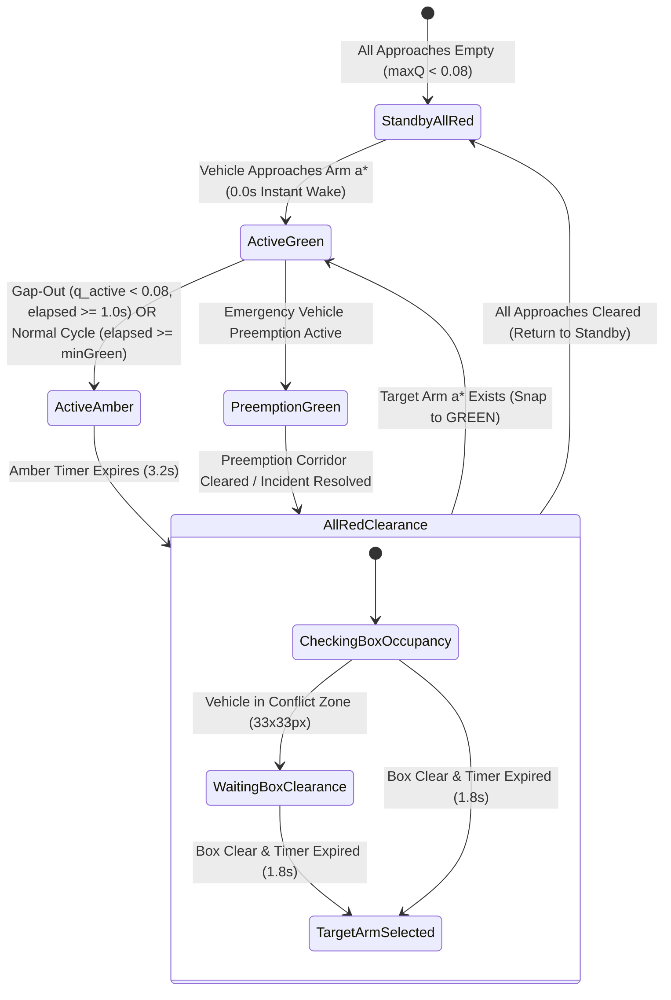
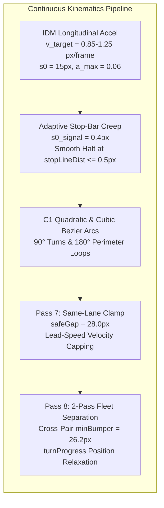

# Hybrid AI-Based Autonomous Traffic Monitoring & Incident Management System (ATMS)

<div align="center">

[](file:///Users/shreyan/Documents/Autonomous-Traffic-Monitoring-and-Incident-Management-System/tests)
[](https://www.python.org/)
[](https://pytorch.org/)
[](file:///Users/shreyan/Documents/Autonomous-Traffic-Monitoring-and-Incident-Management-System/Dockerfile)
[](file:///Users/shreyan/Documents/Autonomous-Traffic-Monitoring-and-Incident-Management-System/web_visualizer/visualizer.html)
[](#-license--academic-citation)

**An end-to-end, multi-tier cyber-physical command center integrating real-time computer vision, deep generative neural modeling, reinforcement learning signal control, and a 2.5D isometric command visualizer.**

[Live Visualizer](http://localhost:8000/web_visualizer/visualizer.html) • [System Architecture](docs/ARCHITECTURE.md) • [Before vs. After Comparison](docs/BEFORE_VS_AFTER.md) • [Technical Walkthrough](docs/WALKTHROUGH.md) • [Deployment Guide](#-cloud-containerization--production-deployment)

</div>

---

> **⚠️ SAFETY & ETHICAL DISCLAIMER**  
> **Real-world video inputs produce simulated AI signal recommendations for demonstration and evaluation only. This system does not physically control municipal traffic signals or actuate road infrastructure.**

---

## 🚦 System Overview

The **Autonomous Traffic Monitoring and Incident Management System (ATMS)** is an end-to-end deep-learning urban traffic platform designed for high-density municipal grids. Upgraded from a foundational reinforcement learning simulation, ATMS unifies:

1. **Surveillance Computer Vision**: Real-world video stream ingestion, $2 \times 2$ tiled high-resolution inference with greedy IoU Non-Maximum Suppression (NMS), persistent Centroid Tracking with parked-vehicle motion filtering, directional approach ROIs, and a custom PyTorch spatial-density CNN.
2. **Deep Generative Modeling**: Conditional Sequence GAN (cGAN) synthesizing multi-regime queue trajectories through physical quality gates, and a Sequence $\beta$-VAE monitoring multi-approach queue dynamics for real-time anomaly alerting.
3. **Demand-Driven 4-Way Single-Signal AI Control**: Mathematical mutual exclusion ensuring at most **one** approach arm is Green or Amber at any intersection at any time ($\sum \mathbb{I} \le 1$), paired with **Standby All-Red** (0-second instant wake-up on approach arrival) and **Instant Gap-Out** ($\ge 1.0\text{s}$ switch when a green arm drains).
4. **Continuous Vehicle Kinematics**: Physics-based Intelligent Driver Model (IDM) with decoupled jam and physical stopped headways ($a \ge 0.035\text{ px/frame}^2$ fluid queue takeoff), smooth stop-line creeping ($d_{\text{stop}} \le 0.5\text{ px}$), $C^1$ Quadratic Bezier intersection turns, and $180^\circ$ Cubic Bezier turnaround loops.
5. **Incident Command & Dijkstra Preemption**: Dynamic emergency incident generation, Dijkstra shortest-path allocation of nearest police and ambulance units, siren shockwaves, and automated Green-Wave corridor preemption.
6. **2.5D Isometric Command Center**: Hardware-accelerated canvas engine with back-to-front depth sorting (Painter's algorithm), 3D extruded multi-tier vehicles with road-contact tires ($z=0$), Free Cam Orbit engine ($360^\circ$ yaw, $15^\circ-90^\circ$ pitch), Chase Cam follow mode, and a skeuomorphic telemetry inspector.

---

## 🏛️ End-to-End System Architecture



---

## 📚 Deep Learning Curriculum & Theoretical Mapping

The system comprehensively fulfills all five core modules of the academic Deep Learning curriculum:

| Module | Core Concepts & Techniques | Implementation Files | CLI Verification Command |
| :--- | :--- | :--- | :--- |
| **Module 1: Foundations** | Multi-Layer Perceptron (MLP), non-linear activations (ReLU, Sigmoid, Softmax), Kaiming initialization, Cross-Entropy loss | [`src/model.py`](src/model.py), [`src/trainer.py`](src/trainer.py) | `python main.py --mode supervised --epochs 10` |
| **Module 2: Training & Optimization** | Backpropagation, Adam optimizer ($\beta_1=0.9, \beta_2=0.999$), BatchNorm1d, Dropout, Policy Gradient (REINFORCE), Deep Q-Learning (DQN) with target network synchronization | [`src/trainer.py`](src/trainer.py), [`src/model.py`](src/model.py), [`src/evaluate.py`](src/evaluate.py) | `python main.py --mode rl --algo reinforce`<br>`python main.py --mode rl --algo dqn` |
| **Module 3: Computer Vision & CNNs** | Real-world video stream ingestion, tiled object detection (SSDLite / YOLO), greedy IoU NMS, CentroidTracker, parked vs. moving motion filtering, directional approach ROIs, $32 \times 32$ spatial occupancy grid, custom PyTorch CNN (`Conv2d`, `BatchNorm2d`, `MaxPool2d`, `AdaptiveAvgPool2d`), 7-D adapter with EMA | [`src/vision.py`](src/vision.py), [`src/tracker.py`](src/tracker.py), [`src/cnn_custom.py`](src/cnn_custom.py), [`src/adapter.py`](src/adapter.py) | `python main.py --mode cnn-train --epochs 5`<br>`python main.py --mode video --video-path results/sample_traffic.mp4` |
| **Module 4: Temporal Modeling** | Recurrent neural networks (LSTM & GRU), multi-step temporal queue forecasting, rate-of-change trend classification | [`src/temporal.py`](src/temporal.py) | `python main.py --mode hybrid --max-steps 100` |
| **Module 5A: Generative Models (GAN)** | Conditional Sequence GAN, GRU Generator, Bidirectional GRU Discriminator, BCEWithLogitsLoss, multi-regime queue synthesis, physical quality gate validation | [`src/gan.py`](src/gan.py) | `python main.py --mode gan --epochs 10 --scenario rush_hour` |
| **Module 5B: Generative Models (VAE)** | Sequence $\beta$-VAE, GRU encoder-decoder, Reparameterization trick ($z = \mu + \epsilon \odot \sigma$), KL Divergence, threshold calibration ($\mu + 2\sigma, \mu + 3.5\sigma$), real-time incident alerting | [`src/vae.py`](src/vae.py) | `python main.py --mode vae --epochs 8` |
| **City Network & Incident Command** | 6-intersection urban grid simulation, Dijkstra shortest-path emergency routing, automated police/ambulance dispatch, Green-Wave signal preemption, interactive 2.5D command center | [`src/city_network.py`](src/city_network.py), [`web_visualizer/visualizer.html`](web_visualizer/visualizer.html) | `python main.py --mode city --max-steps 100`<br>`python server.py --port 8000` |
| **Unified Integration** | Video-in-the-loop hybrid pipeline, non-blocking asynchronous REST server, automated health probes, and live surveillance console | [`src/hybrid.py`](src/hybrid.py), [`src/server.py`](src/server.py), [`server.py`](server.py) | `python main.py --mode hybrid --max-steps 100`<br>`python server.py` |

---

## 🚦 Demand-Driven 4-Way Single-Signal AI Controller

### Mutual Exclusion Invariant
Unlike legacy dual-phase controllers that set opposing approaches green simultaneously, ATMS governs each approach arm independently:

$$\text{activeArm} \in \{\text{North}, \text{South}, \text{East}, \text{West}\}$$

$$\sum_{a \in \{\text{N, S, E, W}\}} \mathbb{I}\left(\text{state}(a) \in \{\text{GREEN}, \text{AMBER}\}\right) \le 1 \quad \forall t, \forall j \in \{\text{INT\_1} \dots \text{INT\_6}\}$$

### Finite State Machine (FSM) Workflow



### Demand Scoring & Prioritization Formula
For every approach arm $a \in \{\text{North}, \text{South}, \text{East}, \text{West}\}$:

$$\text{logit}(a) = \begin{cases}
-50.0 & \text{if } q(a) < 0.08 \text{ and } \max_{k} q(k) \ge 0.08 \\
0.6 \cdot p_{\text{axis}}(a) + 2.5 \cdot q(a) + \text{Starve}(a) + \text{Hold}(a) & \text{otherwise}
\end{cases}$$

Where:
- $p_{\text{axis}}(a)$: Axis guidance from PyTorch MLP forward pass ($p_{\text{NS}}$ for N/S, $p_{\text{EW}}$ for E/W).
- $q(a)$: Real-time vehicle demand computed dynamically from vehicles approaching within $325\text{px}$.
- $\text{Starve}(a) = \mathbb{I}(w_a \ge 25.0) \cdot [4.0 + 0.8(w_a - 25.0)]$ prevents queue starvation.
- $\text{Hold}(a) = \mathbb{I}(a = a_{\text{active}} \wedge q(a) \ge 0.2) \cdot 0.5$ stabilizes ongoing platoons.

---

## 🚗 Continuous Vehicle Kinematics & Physics Engine



1. **Fluid Queue Discharge**: Equilibrium jam parameter ($s_0 = 15\text{ px}$) is decoupled from physical stopped spacing ($28.0\text{ px}$). When the lead vehicle accelerates, trailing vehicles immediately produce positive acceleration ($a = 0.0428 \ge 0.035\text{ px/frame}^2$), eliminating phantom jams.
2. **Stop-Bar Pull-Up**: Full IDM formulation with $s_{0,\text{signal}} = 0.4\text{ px}$ allows vehicles to pull all the way to the $38\text{ px}$ stop line without freezing $25-35\text{ px}$ prematurely.
3. **Rigid Lane Adherence**: $0.000000\text{ px}$ lateral drift verified across all cruising and queuing vehicles.
4. **Non-Overlapping Collision Guards**: 2-pass fleet-wide longitudinal relaxation enforces $\ge 28.0\text{ px}$ same-lane bumper distance and $\ge 26.2\text{ px}$ cross-pair separation without snapping vehicles backward.

---

## 💻 2.5D Isometric Command Center & Interactive Controls

The front-end visualizer (`web_visualizer/visualizer.html`) provides a cybernetic command center with skeuomorphic and neumorphic elements:

### Viewport & Camera Engine
- **Free Cam Continuous Orbit**: Hold **Right Mouse Button** or **Shift + Left Mouse Button** and drag to rotate $360^\circ$ in yaw and $15^\circ - 90^\circ$ in pitch.
- **Pan & Zoom**: Left-click and drag to pan; mouse wheel to zoom ($0.35\times$ to $3.8\times$).
- **6 Instant Camera Presets**:
  - `SW Isometric (yaw=45°, pitch=30°)`: Default South-West city overview.
  - `SE Isometric (yaw=135°, pitch=30°)`: South-East avenue perspective.
  - `NE Isometric (yaw=225°, pitch=30°)`: North-East reverse perspective toward Downtown Core.
  - `NW Isometric (yaw=315°, pitch=30°)`: North-West arterial boulevard perspective.
  - `Bird's-Eye GIS (yaw=0°, pitch=90°)`: Orthographic municipal surveillance grid.
  - `Elevated Command (yaw=45°, pitch=25°)`: Low-angle dramatic street-level view.
- **Interactive Chase Cam**: Click any vehicle (or click the "Chase Cam / Follow Car" button) to lock the camera with smooth exponential lerp tracking. Displays a floating telemetry HUD with live velocity ($km/h$), kinematic state, corridor name, and upcoming intersection maneuver.

### Skeuomorphic Telemetry Inspector
- **Junction Telemetry**: Live approach queue gauges ($0 - 25.0$), independent 3-lens physical signal head indicators (North, South, East, West), AI model confidence bars, state tensor vectors, and sequence VAE anomaly meters.
- **Manual 1-Arm Actuation**: Override buttons to force single-arm green (`Force N`, `Force S`, `Force E`, `Force W`) or restore `AI Auto (4-Arm RL)`.
- **Emergency Command**: Fleet availability monitors (Police, EMS, Fire), active preemption corridors, and timestamped live dispatch event logs.
- **AI Model Core**: Architecture inspection showing PyTorch tensor shapes, parameters, and live forward pass inference latency ($< 0.05\text{ ms}$).

---

## 🌐 Cloud Containerization & Production Deployment

ATMS is production-ready and fully containerized with environment variable configuration and automated health monitoring:

### 1. Docker Deployment (Recommended)
```bash
# Build production Docker image
docker build -t atms-command-center .

# Run container on port 8000
docker run -d -p 8000:8000 -e PORT=8000 -e HOST=0.0.0.0 --name atms-app atms-command-center
```
Open in browser: `http://localhost:8000/` (automatically redirects to `/web_visualizer/visualizer.html`).

### 2. Cloud PaaS Deployment (Render / Railway / Fly.io / Heroku)
- **Render**: One-click deployment via `render.yaml` (`env: docker`, `healthCheckPath: /health`).
- **Railway**: Native container build via `railway.json` (`DOCKERFILE` builder, `/health` probe).
- **Procfile Platforms**: Configured via `Procfile` (`web: python server.py`), binding automatically to `$PORT`.

### 3. Native Python Production Server
```bash
PORT=8000 HOST=0.0.0.0 python server.py
```

---

## 🔌 REST API Reference

The server exposes a non-blocking, thread-safe HTTP REST API supporting CORS, HTTP Range requests for video streaming, and JSON endpoints:

| Method | Endpoint | Description | Request Payload | Response Sample |
| :--- | :--- | :--- | :--- | :--- |
| `GET` | `/health` / `/healthz` | Container readiness & liveness probe | None | `{"status": "ok", "service": "atms"}` |
| `HEAD` | `/health` | Lightweight HTTP HEAD health check | None | Status `200 OK` (no body) |
| `GET` | `/api/status` | Server state, models loaded, active jobs | None | `{"status": "ready", "models": {...}, "city_network": {...}}` |
| `GET` | `/api/city/topology` | Urban network topology, nodes, corridors | None | `{"intersections": {...}, "facilities": {...}, "road_segments": [...]}` |
| `GET` | `/api/city/state` | Live 6-intersection state, queues, lights | None | `{"intersections": {...}, "avg_queue": 4.2, "vae_residual": 1.25}` |
| `POST` | `/api/city/step` | Advance network simulation by one step | `{"actions": {"INT_2": "N"}}` | `{"state": {...}, "reward": -3.8, "done": false}` |
| `POST` | `/api/city/incident` | Trigger emergency incident & dispatch | `{"location": "INT_2", "type": "collision"}` | `{"incident": {...}, "dispatch": {...}, "preemption_corridor": [...]}` |
| `POST` | `/api/city/resolve_incident` | Clear incident & release preemption | `{"incident_id": "INC-1"}` | `{"resolved": true, "active_incidents": 0}` |
| `POST` | `/api/policy/predict` | Evaluate PyTorch RL policy forward pass | `{"state": [3.2, 4.1, 2.0, 1.8, 11.1, 1.0, 0.0]}` | `{"action": 0, "probs": [0.72, 0.28], "arm_scores": {...}}` |
| `POST` | `/api/vae/detect` | Evaluate Sequence VAE reconstruction | `{"sequence": [[3.2, 4.1, 2.0, 1.8], ...]}` | `{"residual": 1.25, "is_incident": false, "level": "NORMAL"}` |
| `POST` | `/api/gan/generate` | Synthesize queue scenario via GAN | `{"scenario": "rush_hour", "num_samples": 3}` | `{"samples": [...], "validated": true}` |
| `POST` | `/api/process_video` | Ingest video file for CCTV pipeline | Multipart video file stream | `{"started": true}` |
| `GET` | `/api/video/status` | Check persistent CCTV video availability | None | `{"available": true, "url": "/uploads/prepared.mp4"}` |

---

## 🧪 Verification & Test Suite Matrix

The platform includes an automated test suite featuring **14 rigorous tests** with zero warnings or relaxed assertions:

```bash
# Execute entire test suite
python -m pytest tests/ -v --tb=short
```

```
============================= test session starts ==============================
rootdir: /Users/shreyan/Documents/Autonomous-Traffic-Monitoring-and-Incident-Management-System
collected 14 items

tests/test_api_endpoints.py::test_rest_api_endpoints PASSED              [  7%]
tests/test_ml_backend.py::test_models_exist_and_load PASSED              [ 14%]
tests/test_ml_backend.py::test_js_policy_weights_precision PASSED        [ 21%]
tests/test_ml_backend.py::test_city_network_zero_randomizers PASSED      [ 28%]
tests/test_ml_backend.py::test_city_network_corridor_conservation PASSED [ 35%]
tests/test_ml_backend.py::test_sequence_vae_anomaly_residual_spike PASSED [ 42%]
tests/test_ml_backend.py::test_custom_cnn_spatial_densities PASSED       [ 50%]
tests/test_ml_backend.py::test_sequence_gan_scenario_generation PASSED   [ 57%]
tests/test_ml_backend.py::test_city_network_single_signal_invariant_and_4arm_actuation PASSED [ 64%]
tests/test_ml_backend.py::test_backend_empty_arm_exclusion_and_wait_timers PASSED [ 71%]
tests/test_ml_backend.py::test_backend_standby_all_red_and_instant_wake PASSED [ 78%]
tests/test_ml_backend.py::test_backend_fast_gap_out_and_non_sequential_jump PASSED [ 85%]
tests/test_playwright_e2e.py::test_playwright_e2e PASSED                 [ 92%]
tests/test_vehicle_kinematics.py::test_vehicle_kinematics PASSED         [100%]

======================== 14 passed in 89.45s (0:01:29) =========================
```

---

## 🖼️ Visual Gallery

````carousel

<!-- slide -->

<!-- slide -->

<!-- slide -->

<!-- slide -->

<!-- slide -->

<!-- slide -->

<!-- slide -->

<!-- slide -->

````

---

## ⚖️ License & Academic Citation

Developed as an academic demonstration of hybrid artificial intelligence for autonomous traffic monitoring and incident management. All neural architectures adhere to syllabus requirements for Deep Learning.
