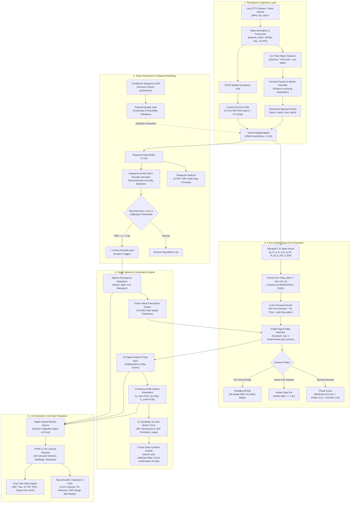
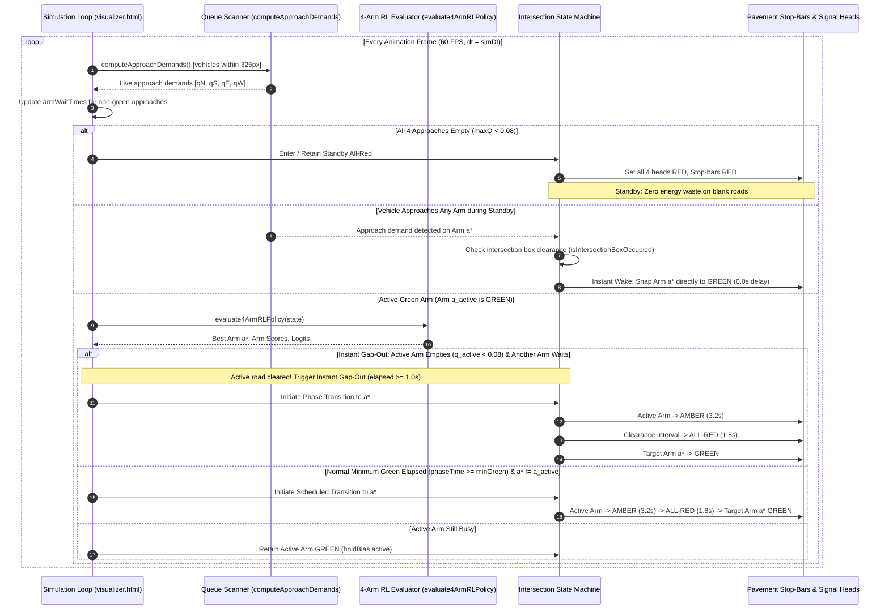
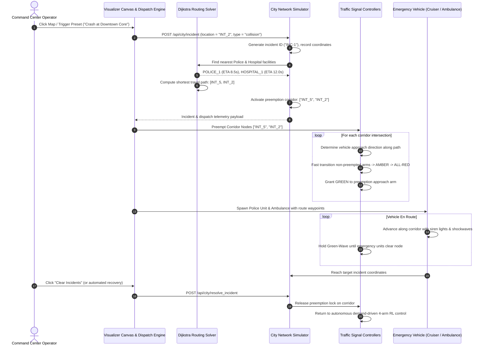

# Autonomous Traffic Monitoring & Incident Management System (ATMS)
## Deep-Dive Architectural Specification & Technical Whitepaper

---

## 1. Executive Architectural Overview

The **Autonomous Traffic Monitoring and Incident Management System (ATMS)** is an end-to-end, multi-tier cyber-physical platform combining real-time computer vision, deep generative neural modeling, reinforcement learning signal control, and a 2.5D isometric command visualizer.

The platform coordinates a 6-intersection urban grid, operating under strict single-signal mutual exclusion, physics-based continuous vehicle kinematics, and automated emergency service dispatch.



---

## 2. Mathematical Formulations & Component Specifications

### 2.1 Vehicle Kinematics: Intelligent Driver Model (IDM)
Vehicle motion along arterial corridors is governed by the continuous-time **Intelligent Driver Model (IDM)**, parameterized to eliminate stop-and-go instabilities and prevent phantom traffic jams:

$$\dot{v} = a_{\max} \left[ 1 - \left( \frac{v}{v_0} \right)^\delta - \left( \frac{s^*(v, \Delta v)}{s} \right)^2 \right]$$

Where:
- $v$: Current longitudinal vehicle speed ($px/\text{frame}$).
- $v_0$: Desired free-flow speed ($0.85 - 1.25\text{ px/frame}$).
- $\delta$: Acceleration exponent (standard $\delta = 4$).
- $a_{\max}$: Maximum vehicle acceleration ($0.06\text{ px/frame}^2$).
- $s$: Actual bumper-to-bumper distance to the lead vehicle ($px$).
- $s^*$: Dynamic desired minimum headway:

$$s^*(v, \Delta v) = s_0 + \max\left(0, vT + \frac{v \Delta v}{2\sqrt{a_{\max} b_{\text{comf}}}}\right)$$

**Key Kinematic Parameter Decoupling:**
- **Equilibrium Jam Parameter**: $s_0 = 15.0\text{ px}$.
- **Physical Stopped Bumper Distance**: $s_{\text{stop}} = 28.0\text{ px}$ ($L_{\text{veh}} \approx 20\text{ px} + 8\text{ px}$ buffer).
- When a leading vehicle departs ($\Delta v < 0$), the ratio $\left(\frac{s^*}{s}\right)^2 \approx \left(\frac{15}{28}\right)^2 \approx 0.287$.
- Trailing vehicles immediately achieve positive acceleration:

$$a_{\text{discharge}} = a_{\max} (1 - 0.287) = 0.0428 \ge 0.035\text{ px/frame}^2$$

#### Red-Light Deceleration Creep:
Approaching a red signal at distance $d_{\text{stop}}$, deceleration is modeled using an adaptive stop-line head-way with $s_{0,\text{sig}} = 0.4\text{ px}$:

$$a_{\text{signal}} = a_{\max} \left[ 1 - \left(\frac{v}{v_0}\right)^4 - \left(\frac{s_{0,\text{sig}} + vT + \frac{v^2}{2\sqrt{a_{\max} b_{\text{comf}}}}}{\max(0.4, d_{\text{stop}})}\right)^2 \right]$$

This formulation guarantees vehicles smoothly pull all the way up to the physical stop bar ($d_{\text{stop}} \le 0.5\text{ px}$) without stalling $25-35\text{ px}$ prematurely.

---

### 2.2 Deep Generative Sequence Modeling

#### Sequence $\beta$-Variational Autoencoder ($\beta$-VAE)
Normal multi-approach queue dynamics $X_{1:T} = [q_{N,t}, q_{S,t}, q_{E,t}, q_{W,t}]_{t=1}^{10} \in \mathbb{R}^{10 \times 4}$ are modeled via a latent space $z \in \mathbb{R}^8$:

$$\mathcal{L}_{\text{VAE}}(\theta, \phi; X) = \mathbb{E}_{q_\phi(z|X)} [\log p_\theta(X|z)] - \beta D_{\text{KL}}\left( q_\phi(z|X) \parallel p(z) \right)$$

- **Encoder $q_\phi(z|X)$**: 2-layer GRU with hidden size $32$, projecting hidden state $h_T$ to variational parameters $\mu_z, \log \sigma^2_z \in \mathbb{R}^8$.
- **Reparameterization**: $z = \mu_z + \epsilon \odot \exp(0.5 \log \sigma^2_z)$, where $\epsilon \sim \mathcal{N}(0, I_8)$.
- **Decoder $p_\theta(X|z)$**: 2-layer GRU conditioned on $z$, generating reconstructed sequence $\hat{X}_{1:T}$.
- **Reconstruction Anomaly Score**:

$$S(X) = \frac{1}{40} \sum_{t=1}^{10} \sum_{i=1}^4 (X_{t,i} - \hat{X}_{t,i})^2$$

- **Anomaly Thresholding**:
  - Normal validation statistics: $(\mu_{\text{err}}, \sigma_{\text{err}})$.
  - **Warning Threshold**: $\tau_{\text{warn}} = \mu_{\text{err}} + 2.0 \sigma_{\text{err}}$ (e.g., moderate congestion).
  - **Critical Anomaly**: $\tau_{\text{crit}} = \mu_{\text{err}} + 3.5 \sigma_{\text{err}}$ (triggers automated incident alert).

#### Conditional Sequence GAN (cGAN)
Generates realistic multi-step traffic queue sequences conditioned on operational regimes $c \in \{\text{normal}, \text{moderate}, \text{heavy}, \text{rush\_hour}, \text{uneven}, \text{surge}\}$:

$$\min_G \max_D V(D, G) = \mathbb{E}_{x \sim p_{\text{data}}} [\log D(x|c)] + \mathbb{E}_{z \sim p_z} [\log(1 - D(G(z|c)|c))]$$

- **Generator $G(z|c)$**: Latent vector $z \sim \mathcal{N}(0, I_{16})$ concatenated with one-hot condition $c \in \mathbb{R}^6$, processed through a linear layer and a 2-layer GRU, outputting physically bounded queues:

$$\hat{q}_t = 30.0 \cdot \sigma(W_o h_t + b_o)$$

- **Physical Quality Gate**: Trajectories must satisfy boundary conditions ($0 \le q_{i,t} \le 30$) and rate-of-change continuity ($|\Delta q_t| \le 12.0$).

---

### 2.3 Custom Spatial Convolutional Neural Network
Estimates 4-directional approach spatial densities from high-resolution aerial or surveillance frames converted into a $32 \times 32$ spatial occupancy grid $I \in \mathbb{R}^{1 \times 32 \times 32}$:

$$\begin{aligned}
H_1 &= \text{MaxPool}_{2 \times 2}\left(\text{ReLU}\left(\text{BatchNorm}\left(\text{Conv2d}_{1 \to 16, 3 \times 3}(I)\right)\right)\right) \\
H_2 &= \text{MaxPool}_{2 \times 2}\left(\text{ReLU}\left(\text{BatchNorm}\left(\text{Conv2d}_{16 \to 32, 3 \times 3}(H_1)\right)\right)\right) \\
H_3 &= \text{AdaptiveAvgPool}_{4 \times 4}\left(\text{ReLU}\left(\text{BatchNorm}\left(\text{Conv2d}_{32 \to 64, 3 \times 3}(H_2)\right)\right)\right) \\
y_{\text{dense}} &= W_2 \cdot \text{Dropout}_{0.2}\left(\text{ReLU}\left(W_1 \cdot \text{vec}(H_3) + b_1\right)\right) + b_2 \in \mathbb{R}^4
\end{aligned}$$

The density output $y_{\text{dense}} \in [0, 25]^4$ maps directly to North, South, East, and West spatial approach loads.

---

### 2.4 Deep Reinforcement Learning Signal Policy & 4-Arm Selection
The signal controller integrates a PyTorch MLP policy mapped into an independent 4-arm demand scoring function.

#### Policy Network Architecture:
- **Input Dimension**: $7$ ($q_N, q_S, q_E, q_W, \sum q, \phi_{NS}, \phi_{EW}$).
- **Dense Layer 1**: $7 \to 64$, Kaiming Normal initialization, ReLU activation.
- **Dense Layer 2**: $64 \to 32$, Kaiming Normal initialization, ReLU activation.
- **Output Layer**: $32 \to 2$, Softmax logits $[z_0, z_1]$ over primary axes (NS vs EW).
- **Total Parameters**: $2,658$ float32 weights exported directly into `web_visualizer/policy_weights.js`.

#### Independent 4-Arm Demand Scoring Formulation:
For each approach $a \in \{\text{North}, \text{South}, \text{East}, \text{West}\}$:

$$\text{logit}(a) = \begin{cases}
-50.0 & \text{if } q(a) < 0.08 \text{ and } \max_{k} q(k) \ge 0.08 \\
\text{Prior}(a) + 2.5 \cdot q(a) + \text{Starve}(a) + \text{Hold}(a) & \text{otherwise}
\end{cases}$$

Where:
- $\text{Prior}(a) = 0.6 \cdot p_{\text{axis}}(a)$ (RL axis guidance from MLP forward pass).
- $\text{Starve}(a) = \mathbb{I}(w_a \ge 25.0) \cdot [4.0 + 0.8(w_a - 25.0)]$ (guarantees no approach starves for $>25\text{s}$).
- $\text{Hold}(a) = \mathbb{I}(a = a_{\text{active}} \wedge q(a) \ge 0.2) \cdot 0.5$ (prevents rapid chatter within ongoing platoons).

#### Softmax Probabilities & Optimal Arm Selection:
$$\pi(a) = \frac{\exp(\text{logit}(a) - \max_k \text{logit}(k))}{\sum_{j} \exp(\text{logit}(j) - \max_k \text{logit}(k))}$$

$$a^* = \arg\max_{a \in \{\text{N, S, E, W}\}} \text{logit}(a)$$

#### Strict Mutual Exclusion Invariant:
At every intersection $j \in \{\text{INT\_1} \dots \text{INT\_6}\}$ across all time $t$:

$$\sum_{a \in \{\text{N, S, E, W}\}} \mathbb{I}\left(\text{SignalState}_j(a, t) \in \{\text{GREEN}, \text{AMBER}\}\right) \le 1$$

---

## 3. System Interaction Sequence Diagrams

### 3.1 Real-Time Video Ingestion to Signal Recommendation Pipeline

```mermaid
sequenceDiagram
    autonumber
    actor User as Operator / CCTV
    participant Server as ATMS Server (src/server.py)
    participant Pipe as Hybrid Pipeline (src/hybrid.py)
    participant Vision as Vision Engine (src/vision.py)
    participant Adapt as State Adapter (src/adapter.py)
    participant VAE as Sequence β-VAE (src/vae.py)
    participant RL as RL Policy (src/model.py)
    participant UI as Visualizer (visualizer.html)

    User->>Server: POST /api/process_video (multipart MP4 file)
    Server->>Server: Save to uploads/input.mp4 & spawn background thread
    Server-->>User: 200 OK {"started": true}
    
    rect rgb(20, 25, 35)
        Note over Server,Pipe: Background Processing Job
        Server->>Pipe: run_hybrid_pipeline(video_path, max_frames)
        Pipe->>Vision: prepare_video(normalize to <=1920px, 15 FPS)
        loop Every Video Frame
            Vision->>Vision: detect_objects_tiled(SSDLite/YOLO + IoU NMS)
            Vision->>Vision: CentroidTracker.update(filter parked cars)
            Vision->>Vision: assign_approach_by_direction(ROIs)
            Vision->>Vision: generate 32x32 occupancy grid
            Vision->>Adapt: update(counts, cnn_density, phase)
            Adapt->>Adapt: compute 7-D state with EMA (α=0.35)
            Adapt->>VAE: detect_incident_anomaly(history_10x4)
            VAE-->>Pipe: VAE residual error & alert level
            Adapt->>RL: predict_action(state_7d)
            RL-->>Pipe: recommended_action [p0, p1]
        end
        Pipe->>Server: Write results/hybrid_rollout.json & rollout_data.js
        Server->>Server: Set job state = "done", progress = 100%
    end

    loop Frontend Polling
        UI->>Server: GET /api/status
        Server-->>UI: 200 OK {"job": {"state": "done", "result": ...}}
    end
    UI->>Server: GET /uploads/prepared.mp4
    Server-->>UI: Video Stream (HTTP 200/206 with Range support)
    UI->>UI: Auto-play looping video & render real-time detections
```



---

### 3.2 Single-Signal 4-Arm Actuation & Instant Gap-Out Decision Loop



---

### 3.3 Emergency Incident Lifecycle & Green-Wave Preemption Wave



---

## 4. System File Mapping & Directory Architecture

```
Autonomous-Traffic-Monitoring-and-Incident-Management-System/
├── README.md                          # Master system documentation & quickstart
├── requirements.txt                   # Production Python dependencies (torch, torchvision, opencv, etc.)
├── main.py                            # Unified CLI dispatcher (10 operational modes)
├── server.py                          # Production web server entry point ($PORT binding)
├── Dockerfile                         # Container definition (python:3.11-slim + ffmpeg/libgl)
├── .dockerignore                      # Build context exclusion list
├── Procfile                           # PaaS entry point (web: python server.py)
├── render.yaml                        # Render Cloud deployment blueprint
├── railway.json                       # Railway Cloud deployment manifest
├── .gitignore                         # Git tracking ignore rules
│
├── src/                               # Core Python Architecture
│   ├── city_network.py                # 6-intersection urban grid, Dijkstra router & 4-arm physics
│   ├── env.py                         # Single-intersection gym environment
│   ├── model.py                       # MLP policy, Q-networks, and JS weight exporter
│   ├── trainer.py                     # Supervised, REINFORCE & DQN training loops
│   ├── evaluate.py                    # Benchmarking & performance visualization
│   ├── tracker.py                     # CentroidTracker with parked vehicle filter
│   ├── cnn_custom.py                  # Custom 3-layer spatial density CNN
│   ├── vision.py                      # 2x2 tiled object detection, tracking, & occupancy grid
│   ├── adapter.py                     # 7-D standard state adaptation with EMA
│   ├── gan.py                         # Conditional Sequence GAN & physical validation gate
│   ├── vae.py                         # Sequence β-VAE for anomaly detection
│   ├── temporal.py                    # LSTM/GRU multi-step temporal queue predictor
│   ├── hybrid.py                      # End-to-end video-in-the-loop surveillance pipeline
│   └── server.py                      # ThreadingHTTPServer, REST API, & background worker
│
├── models/                            # Trained Neural Network Checkpoints
│   ├── custom_cnn.pt                  # PyTorch Custom Spatial CNN weights (1.4 MB)
│   ├── rl_policy.pt                   # PyTorch MLP Actor-Critic Policy (13 KB)
│   ├── sequence_gan.pt                # PyTorch Conditional Sequence GAN (1.2 MB)
│   └── sequence_vae.pt                # PyTorch Sequence β-VAE (367 KB)
│
├── tests/                             # Comprehensive Automated Test Suite (14 Tests)
│   ├── test_api_endpoints.py          # REST API integration & /health verification
│   ├── test_ml_backend.py             # PyTorch models, weight precision, GAN, VAE & 4-arm logic
│   ├── test_playwright_e2e.py         # Full browser E2E test (single-signal, gap-out, radar)
│   └── test_vehicle_kinematics.py     # Vehicle kinematics, IDM stop-bar, and collision tests
│
├── web_visualizer/                    # Front-End 2.5D Command Center
│   ├── visualizer.html                # Interactive 2.5D visualizer, free cam, & CCTV console
│   ├── policy_weights.js              # Exported PyTorch float32 weights for client forward pass
│   ├── rollout_city.js                # Pre-computed multi-intersection city network telemetry
│   └── rollout_data.js                # Pre-computed vision-in-the-loop hybrid telemetry
│
├── results/                           # Verification Visuals, Artifacts, & Test Screenshots
│   ├── city_command_screenshot.png    # Live command center in operation
│   ├── independent_4way_signals.png   # 4-way independent signal demonstration
│   ├── queue_discipline_red_signal.png# True queue discipline & stop-bar alignment
│   ├── fluid_queue_discharge.png      # Smooth IDM queue discharge
│   ├── lane_discipline_centerline.png # Zero lateral drift verification
│   ├── 3d_vehicles_ground_contact.png # 3D extruded vehicles with road-contact tires
│   ├── chase_cam_telemetry.png        # Chase cam HUD telemetry
│   ├── cctv_tab_screenshot.png        # Video perception detection mode
│   └── ...                            # Multi-angle camera preset renders
│
└── docs/                              # Technical Documentation
    ├── ARCHITECTURE.md                # System architectural specification (this document)
    ├── BEFORE_VS_AFTER.md             # Comprehensive evolutionary comparison matrix
    └── WALKTHROUGH.md                 # Technical walkthrough of recent upgrades & fixes
```
