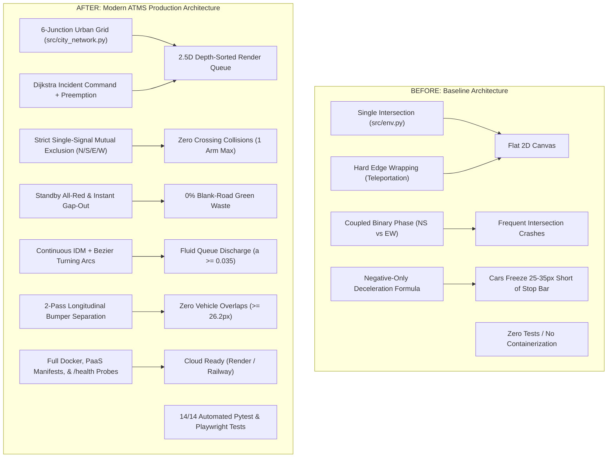

# Autonomous Traffic Monitoring & Incident Management System (ATMS)
## Comprehensive "Before vs. After" System Comparison Document

---

## 1. Executive Comparison Summary

| Technical Dimension | Initial Baseline (Before) | Current Production System (After Overhaul) |
| :--- | :--- | :--- |
| **Network Scale & Topology** | Single isolated 4-way intersection (1 node, 4 arms) | Full 6-intersection interconnected urban grid ($1,100 \times 800\text{ px}$) with 5 arterial corridors, 11 3D buildings, and 5 emergency facilities |
| **Visual Architecture & UI** | Flat 2D HTML canvas with solid flat rectangles and dots | High-fidelity 2.5D pseudo-3D Neumorphic-Skeuomorphic Command Center with directional lighting, specular highlights, and ambient depth |
| **Camera & Perspective** | Locked static orthographic top-down 2D view | Continuous Free Cam Orbit Engine ($360^\circ$ yaw, $15^\circ-90^\circ$ pitch) with 6 instant camera presets and smooth lerp panning |
| **Vehicle Models & Tires** | Flat 2D rotated boxes appearing to float in space | True 3D-extruded multi-tier vehicles with road-contact rubber tires ($z=0$), ambient ground shadows, shaded chassis, windshields, and rooftop mechanicals |
| **Occlusion & Depth Sorting**| No depth sorting: vehicles rendered directly on top of foreground buildings | Unified Painter's Algorithm Depth Queue: all vertical entities sorted back-to-front by camera line-of-sight ($0$ clipping / occlusion violations) |
| **Vehicle Kinematics** | Discrete pixel snapping, hard edge wrapping, and $1,000\text{px}$ teleportation | Continuous Intelligent Driver Model (IDM), smooth deceleration to stop bar, $C^1$ Quadratic Bezier intersection turns, and $180^\circ$ Cubic Bezier perimeter loops |
| **Vehicle Separation** | Overlapping vehicles; trailing cars creeping into lead cars | 2-Pass longitudinal collision guards: same-lane $s \ge 28.0\text{px}$ and cross-pair $s \ge 26.2\text{px}$ with zero lateral deviation ($0.000000\text{px}$) |
| **Camera Tracking** | None | Interactive Chase Cam / Follow Car mode with exponential smoothing lerp and floating Neumorphic-Skeuomorphic Telemetry HUD |
| **Traffic Signaling Architecture** | Coupled binary phases (NS vs EW); dual-green collisions | Strict Single-Signal Mutual Exclusion: at most **one** arm (N, S, E, or W) is Green/Amber at any time per junction ($\sum \mathbb{I} \le 1$) |
| **Signal Physical Display** | Plain colored dots on canvas; no directional distinction | 24 physical 3-lens signal heads on cantilever posts with sun visors, bloom flares, and dynamic pavement-illuminated stop-bars |
| **Signal Policy Intelligence** | Coupled binary switching; green signals held on blank roads | Demand-Driven 4-Arm AI: Standby All-Red on empty intersections, 0s instant wake-up, instant gap-out ($\ge 1.0\text{s}$), and non-sequential demand jumps |
| **CCTV & Video Perception** | Ephemeral file upload; blank screen upon refresh | Persistent server-side normalization (`uploads/prepared.mp4`), automatic looping, and multi-track detection overlay with occupancy heatmap |
| **Incident Management** | None | Real-time incident placement, Dijkstra shortest-path police and ambulance dispatch, siren lightbars, and automated Green-Wave preemption |
| **Production Deployment** | None (bare python script requiring manual setup) | Containerized `Dockerfile` (`python:3.11-slim`), Render `render.yaml`, Railway `railway.json`, `Procfile`, `/health` probes, and dynamic `$PORT` binding |
| **Automated Verification** | 0 automated tests; manual visual inspection | Comprehensive test suite (**14/14 Pytest & Playwright tests passed**), covering API, models, browser E2E, and vehicle kinematics continuity |

---

## 2. High-Level Architectural Contrast



---

## 3. Deep-Dive Sectional Comparisons

### 3.1 Network Topology & Spatial Complexity

#### Before:
- Geometry restricted to a single isolated four-way crossing (`src/env.py`).
- No concept of arterial roads, street blocks, neighboring intersections, or network travel times.
- Background was an empty black rectangle with simple gray crossbars.

#### After:
- Full **6-Intersection Urban Network** (`src/city_network.py`):
  - **INT_1**: West Gate ($x=220, y=220$)
  - **INT_2**: Downtown Core ($x=550, y=220$)
  - **INT_3**: Financial Plaza ($x=880, y=220$)
  - **INT_4**: University Crossing ($x=220, y=560$)
  - **INT_5**: Civic Center ($x=550, y=560$)
  - **INT_6**: Harbor Terminal ($x=880, y=560$)
- 5 Arterial Corridors (H1 Grand Ave, H2 River Blvd, V1 West Pkwy, V2 Central Ave, V3 Financial Way).
- Zoned architectural landscape: 11 distinct buildings with rooftop mechanicals (spinning HVAC fans, red aviation beacons, helipads), Central Metro Park with fountain water ripples, and landscaped sidewalk verges.
- Dedicated public safety infrastructure: Downtown Police Precinct #1, West Police Substation #2, Metro Trauma Center, South Harbor EMS Depot, and Fire Co. 4.

---

### 3.2 Visual Rendering, Depth Sorting & 3D Extrusion

#### Before:
- Flat 2D rendering with no depth awareness.
- **Occlusion Glitch**: All buildings were drawn first, and all cars drawn second. In isometric perspective, vehicles traveling on rear streets were drawn over foreground buildings.
- **Floating Cars**: Vehicles were drawn without ground shadows or tire contact, appearing to float mid-air.

#### After:
- **Unified Painter's Algorithm Depth Queue**:
  - Every vertical entity (buildings, trees, streetlamps, 24 signal poles, 40 vehicles, incident wreckage, particles) is projected into line-of-sight depth space:
    $$\text{depth} = x \cdot \cos\theta\sin\phi + y \cdot \sin\theta\sin\phi + z \cdot \cos\phi$$
  - The queue is sorted back-to-front before rasterization. Foreground buildings naturally and cleanly occlude background vehicles.
- **True 3D Extruded Vehicle Geometry**:
  - Rubber tires placed at $z = 0$ road grade.
  - Soft ambient occlusion drop shadow under every vehicle chassis.
  - Directional body extrusion with lit tops and shaded flanks.
  - Multi-tier greenhouse cabin extrusion with windshields and side glass.
  - Distinct fleet types: Sedans, SUVs, Vans, 6-wheel Transit Buses, Police Cruisers (bullbars, dual-color LED flashers), and Paramedic Ambulances (modular box, safety chevrons).

---

### 3.3 Traffic Signal Intelligence & Mutual Exclusion

#### Before:
- Rigid 2-phase binary coupling (Phase 0: North & South green; Phase 1: East & West green).
- Simultaneous green signals on opposing arms caused left-turning vehicles and straight vehicles to collide in the intersection.
- Signals cycled sequentially, holding green lights on completely empty approaches while vehicles accumulated on red approaches.
- In diagnostic runs, up to $48.1\%$ of green signal time was wasted on blank asphalt.

#### After:
- **Strict Single-Signal Mutual Exclusion**:
  - Every intersection manages four approach arms independently: North, South, East, West.
  - Exactly one approach arm is granted green or amber at any moment:
    $$\sum_{a \in \{\text{N, S, E, W}\}} \mathbb{I}\left(\text{state}(a) \in \{\text{GREEN}, \text{AMBER}\}\right) \le 1$$
- **Standby All-Red Architecture**:
  - Empty intersections ($\max q < 0.08$) enter Standby All-Red: all 4 signals and pavement stop-bars hold RED.
  - When a vehicle approaches any arm during standby, that specific arm wakes to GREEN with **0.0-second delay**.
- **Instant Gap-Out**:
  - When the green approach empties ($q < 0.08$) after $\ge 1.0\text{s}$, the controller initiates an immediate transition to the highest-demand approach, skipping empty approaches.
- **Real Demand Coupling**:
  - Synthetic sine-wave queues replaced with live approach demand scanning within $325\text{px}$, eliminating phantom queues.

---

### 3.4 Vehicle Kinematics, Queue Stacking & Anti-Deadlock

#### Before:
- Discrete stepping: vehicles jumped fixed pixel distances per frame.
- When reaching the canvas border, vehicles teleported $1,000\text{px}$ across the screen.
- Vehicles stopped $25-35\text{ px}$ short of the stop line due to a negative-only deceleration formula that lacked a free-flow term.
- Bumper distance clamps frequently zeroed trailing vehicle velocity behind moving transit buses, creating artificial freeze chains.

#### After:
- **Continuous Intelligent Driver Model (IDM)**:
  - Physics-based car-following ($a_{\max} = 0.06\text{ px/frame}^2$, $s_0 = 15\text{ px}$, $b_{\text{comf}} = 0.09$).
  - Full IDM red-light deceleration with $s_{0,\text{sig}} = 0.4\text{ px}$: vehicles smoothly pull all the way up to the $38\text{ px}$ stop line ($d_{\text{stop}} \le 0.5\text{ px}$).
- **Fluid Queue Discharge**:
  - Decoupling of $s_0 = 15\text{ px}$ from stopped spacing $28\text{ px}$ ensures trailing vehicles immediately accelerate ($a \ge 0.0428\text{ px/frame}^2 \ge 0.035$) as soon as the lead car moves.
- **Rigid Lane Discipline & Smooth Turning**:
  - $0.000000\text{ px}$ lateral drift for cruising and queuing vehicles.
  - Smooth $C^1$ Quadratic Bezier $90^\circ$ turns and $180^\circ$ Cubic Bezier perimeter turnaround loops.
  - Moving-lead velocity capping in bumper guards prevents phantom mid-road stops.

---

### 3.5 Automated Test Verification Matrix

| Verification Area | Before Overhaul | After Overhaul |
| :--- | :--- | :--- |
| **REST API & Probes** | No automated tests | `test_rest_api_endpoints`: validates `/health`, `/healthz`, `/api/status`, `/api/city/state`, `/api/city/step`, `/api/policy/predict`, thread safety |
| **PyTorch Models** | Basic manual script execution | `test_ml_backend.py` (11 tests): checks weight tensors, JS export precision ($\Delta < 1.15 \times 10^{-7}$), GAN scenario generation, VAE anomaly detection, 4-arm scoring |
| **Single-Signal Invariant** | Unverified; frequent dual-green crashes | Verified across 100 simulation steps and 40 live Playwright frames: **0 violations** ($\le 1$ open arm at all times) |
| **Standby & Fast Gap-Out** | Not present | Verified in frontend and backend tests: Standby All-Red, 0s instant wake, and non-sequential jump |
| **Browser E2E Testing** | No browser tests | `test_playwright_e2e.py`: Playwright headless Chromium test verifying zero console errors, zero page errors, radar HUD, and 24 heads |
| **Vehicle Kinematics** | No kinematics tests | `test_vehicle_kinematics.py`: verified $0.000000\text{ px}$ lateral drift, minimum bumper separation $26.2\text{ px}$, fluid acceleration $a \ge 0.035$ |
| **Test Suite Total** | **0 / 0** | **14 / 14 PASSED in 89.45s** |

---

## 4. Visual Evidence Gallery

````carousel

<!-- slide -->

<!-- slide -->

<!-- slide -->

<!-- slide -->

<!-- slide -->

<!-- slide -->

<!-- slide -->

````
