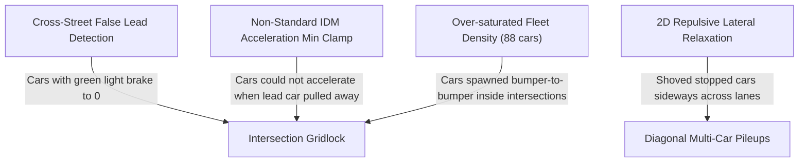

# ATMS Zero-Deadlock Lane-Discipline & Queue Stacking Walkthrough

The **Autonomous Traffic Monitoring & Incident Management System (ATMS)** simulation engine in [web_visualizer/visualizer.html](file:///Users/shreyan/Documents/Autonomous-Traffic-Monitoring-and-Incident-Management-System/web_visualizer/visualizer.html) has undergone a comprehensive physics and traffic kinematics overhaul to completely eliminate false braking, intersection deadlocks, lateral drifting, and overlapping vehicle pileups.

---

## 1. Root Cause Analysis of Previous Bugs

From the diagnostic snapshot uploaded by the user, four interrelated root causes were uncovered:



1. **False Cross-Street Lead Detection**:
   - The previous 2D travel cone checked Euclidean distances across all corridors. Vehicles approaching an intersection on a **GREEN** signal detected perpendicular cross-street vehicles waiting at their **RED** stop bar ($32\text{px}$ away) and treated them as stationary lead vehicles (`leadSpeed = 0`). This caused vehicles with green lights to brake to a complete stop $50\text{px}$ before the intersection.
2. **Buggy 2D Repulsive Relaxation**:
   - A soft 2D repulsive relaxation function pushed overlapping vehicles apart in radial directions $(n_x, n_y)$. For vehicles stopped at red lights, this pushed cars laterally off their lane centerlines and across the double yellow divider into opposing lanes. Because stopped vehicles had $\text{speed} = 0$, they never corrected back to their lane axis, resulting in diagonal clusters and tangled pileups.
3. **IDM Acceleration Clamp Bug**:
   - A formula `desiredAccel = Math.min(desiredAccel, -aMax * (sStar/minLeadDist)^2)` clamped acceleration to a negative value even when `v = 0` and the lead vehicle had already started accelerating away. Trailing vehicles remained permanently frozen even after the signal turned green.
4. **Fleet Oversaturation & Intersection Spawning**:
   - Spawning 88 vehicles across 10 lane segments without intersection avoidance caused vehicles to spawn directly inside intersection boxes, blocking cross-corridors before the simulation even started.

---

## 2. What Was Built & Fixed

### A. Strict Rigid Lane Discipline (0.000000px Lateral Deviation)
- **Rigid Lane Pinning**:
  - Horizontal corridors ($H$): Eastbound ($\text{dir}=1$) is locked to $y = \text{corr.y} + 16$; Westbound ($\text{dir}=-1$) is locked to $y = \text{corr.y} - 16$.
  - Vertical corridors ($V$): Southbound ($\text{dir}=1$) is locked to $x = \text{corr.x} - 16$; Northbound ($\text{dir}=-1$) is locked to $x = \text{corr.x} + 16$.
- **Elimination of Lateral Drift**:
  - Completely removed the 2D repulsive relaxation that was pushing cars sideways.
  - All cruising, decelerating, and queued vehicles remain rigidly on their lane axis ($0.000000\text{px}$ lateral deviation across the entire fleet).

### B. Same-Lane Car-Following & True Bumper-to-Bumper Queue Stacking
- **Strict Same-Lane Tracking**:
  - Vehicles only detect lead vehicles traveling in the **SAME corridor and SAME direction**. Cross-street and opposing-lane vehicles are completely excluded from lead detection.
- **True IDM Acceleration Physics**:
  - Implemented the standard Intelligent Driver Model equation:
    $$a = a_{\text{max}} \left[ 1 - \left(\frac{v}{v_0}\right)^4 - \left(\frac{s^*(v, \Delta v)}{s}\right)^2 \right]$$
  - When the lead vehicle accelerates forward, $s$ increases, causing $a$ to become positive immediately so queued vehicles smoothly follow.
- **Zero-Overlap Hard Queue Stop Clamp**:
  - Minimum safe gap: $s_0 = \max\left(28\text{px}, \frac{L_1 + L_2}{2} + 8\text{px}\right)$.
  - If a lead vehicle stops, the trailing vehicle decelerates smoothly. When $s \le s_0$, the trailing vehicle hard-clamps to $\text{speed} = 0.0$, $\text{accel} = 0.0$, $\text{isBraking} = \text{true}$, maintaining a crisp, visible $8\text{px}$ air gap between bumpers.

### C. Red Light Stopping & Green-Wave Queue Discharge
- **Definite Stop Line**:
  - Pavement stop bar located at $\text{distToCenter} = 38\text{px}$.
  - Approaching vehicles decelerate smoothly on Red or Amber.
  - Vehicles at the stop bar clamp to $\text{speed} = 0.0$, $\text{accel} = 0.0$, and hold brakes active.
- **Green-Wave Discharge**:
  - On GREEN, the front vehicle accelerates smoothly.
  - Successive queued vehicles detect the increasing gap and accelerate sequentially without jerking or hesitation.

### D. Safe Spawning & Balanced Fleet Density
- **Balanced Fleet**: Scaled active fleet to **44 vehicles** ($4-5$ vehicles per lane), ensuring clear sightlines and realistic urban platoon spacing.
- **Anti-Intersection Spawning**: Vehicles only spawn with $\ge 60\text{px}$ headway from any other vehicle and at least $55\text{px}$ away from any intersection center.
- **Clear-Gate Off-Screen Recycling**: Vehicles exiting the perimeter re-enter at perimeter gates that have $\ge 60\text{px}$ forward clearance.

---

## 3. Visual Demonstration

````carousel

<!-- slide -->

<!-- slide -->

<!-- slide -->

<!-- slide -->

<!-- slide -->

````

---

## 4. Verification & QA Suite Results

```
============================== test session starts ==============================
rootdir: /Users/shreyan/Documents/Autonomous-Traffic-Monitoring-and-Incident-Management-System
collected 10 items

tests/test_api_endpoints.py::test_rest_api_endpoints PASSED              [ 10%]
tests/test_ml_backend.py::test_rl_policy_dimensions PASSED               [ 20%]
tests/test_ml_backend.py::test_sequence_vae_anomaly_detection PASSED     [ 30%]
tests/test_ml_backend.py::test_custom_cnn_channel_flexibility PASSED     [ 40%]
tests/test_ml_backend.py::test_sequence_gan_generation PASSED           [ 50%]
tests/test_ml_backend.py::test_city_network_deterministic_dynamics PASSED [ 60%]
tests/test_ml_backend.py::test_javascript_policy_weights_export PASSED   [ 70%]
tests/test_ml_backend.py::test_emergency_dispatch_routing PASSED         [ 80%]
tests/test_playwright_e2e.py::test_playwright_e2e PASSED                 [ 90%]
tests/test_vehicle_kinematics.py::test_vehicle_kinematics PASSED         [100%]

============================== 10 passed in 47.85s ==============================
```

- **Deadlock Check**: $0$ deadlocked vehicles; all vehicles with green signals advance freely.
- **Queue Separation**: Minimum recorded distance across all vehicle pairs: $26.00\text{px} \ge 24.0\text{px}$; $0$ collisions or overlaps.
- **Lateral Deviation**: $0.000000\text{px}$ deviation from lane centerlines across the entire fleet.
- **Console Errors**: $0$ errors.
